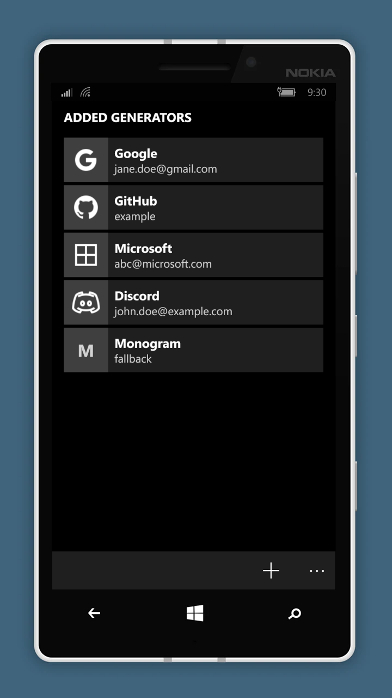

# Digits
Digits is an authenticator app for Windows desktop and Windows 10 Mobile. It generates time-based and counter-based one-time passwords (TOTP and HOTP) from tokens added by QR code or entered manually. The minimum supported Windows version is **10.0.14393.0**.

## Features
- TOTP generation with SHA-1, SHA-256, or SHA-512, configurable code length and period
- HOTP generation with a persisted counter that advances when a code is revealed
- QR code scanning for standard `otpauth://` provisioning links, using the device camera
- Manual token entry for TOTP and HOTP
- Automatically selected issuer icons with light and dark variants, plus a monogram fallback
- Token editing and deletion, duplicate detection, and guidance for an empty token list
- Password-encrypted JSON and XML backup export and import, with duplicate and invalid-entry reporting
- Optional app lock using the device's Windows Hello or sign-in credential (disabled by default)
- English and Russian interface resources

Token generation and storage are handled on the device. QR scanning requires camera access.

The service icons are from [Icons8](https://icons8.com).

## Build and deploy
Use Windows with Visual Studio and the **Universal Windows Platform development** workload. The project targets Windows 10 SDK **10.0.15063.0** and supports devices from **10.0.14393.0** onward. Open `Digits.sln` and build or deploy the `Digits` project from Visual Studio:
- Select **x64** (or **x86**) for desktop deployment
- Select **ARM** for Windows 10 Mobile

For a clean checkout, create a local development certificate in Visual Studio's package-signing settings.

## License
Digits' source code is distributed under the **GNU GPL 3.0** license. See [LICENSE](LICENSE) and [THIRD-PARTY-NOTICES.txt](THIRD-PARTY-NOTICES.txt) for license text and third-party attributions.
